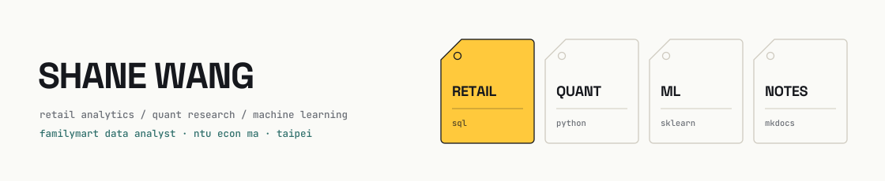

<!-- DRAFT for review — not published. Numbers marked TODO must be filled in by Shane. -->
<picture>
  <source media="(prefers-color-scheme: dark)" srcset="assets/banner-dark.svg">
  
</picture>

Retail data analyst at FamilyMart. I turn store-level data into decisions, and
use side projects to run the same methods against Taiwan equities.

[Knowledge base](https://yuhsunwang.github.io/knowledge-base-pages/) · [LinkedIn](https://www.linkedin.com/in/yu-hsun-wang-231734184/?locale=zh)

---

## Projects

Each row is a thing that shipped and the number that says how well.

### [CVS Radar](https://github.com/YuHsunWang/cvs-radar)

Ranks convenience-store products from PTT reviews. Bayesian credibility
weighting stops one loud review from moving a ranking, and every score traces
back to the posts behind it.

`TODO: N products ranked from M posts` · `python · duckdb · nlp`

### [Trading Strategy Research](https://yuhsunwang.github.io/knowledge-base-pages/trading/)

Taiwan equity strategy research: factor construction, backtesting, and signal
evaluation. Code is private; the notes, backtests, and results are public in the
knowledge base.

`TODO: universe size · backtest window · Sharpe / MDD` · `python · pandas · plotly`

### [Knowledge Base](https://github.com/YuHsunWang/knowledge-base-pages)

Public research notes on trading, machine learning, industry analysis, and AI
engineering. Drafted in Obsidian, published with MkDocs, maintained on an
AI-assisted workflow that keeps notes, backtests, and code in one graph.

`TODO: N published notes` · `mkdocs · obsidian`

### [Mahjong GTO Trainer](https://github.com/YuHsunWang/gto_mahjong)

Taiwan 16-tile mahjong solver: shanten and ukeire analysis, Monte Carlo win-rate
simulation, deal-in risk, and EV-ranked discard advice. Probabilities are
calibrated against its own bots, not human play — stated up front in the docs.

`TODO: simulated hands per estimate` · `python · fastapi · monte carlo`

### [MCMC Portfolio](https://github.com/YuHsunWang/mcmc-portfolio)

Bayesian preference model fit with Metropolis-Hastings, estimating browsing
preference, diversity preference, and switching cost from choice data.

`TODO: sample size · headline estimate` · `python · pymc · numpy`

### [TOEIC Master](https://github.com/YuHsunWang/toeic-master) · [Live](https://toeic-master-murex.vercel.app)

A TOEIC practice PWA that generates exercises and grades them with the Gemini
API. Installable, works offline.

`TODO: question types / users` · `react · vite · gemini`

### [Financial Engineering](https://github.com/YuHsunWang/Financial_Engineering)

Option pricing and risk metrics from scratch: Black-Scholes, Monte Carlo, Greeks.
Numerical results checked against the analytic solutions.

`TODO: max pricing error vs analytic` · `python · numpy · scipy`

---

## Toolkit

Analysis `python · r · sql · scikit-learn · statsmodels · scipy`
Visualization `power bi · plotly · matplotlib · seaborn`
Data `mysql · duckdb · mongodb`

---

## Contact

[LinkedIn](https://www.linkedin.com/in/yu-hsun-wang-231734184/?locale=zh) ·
[Email](mailto:ddtbcf5845@gmail.com)
